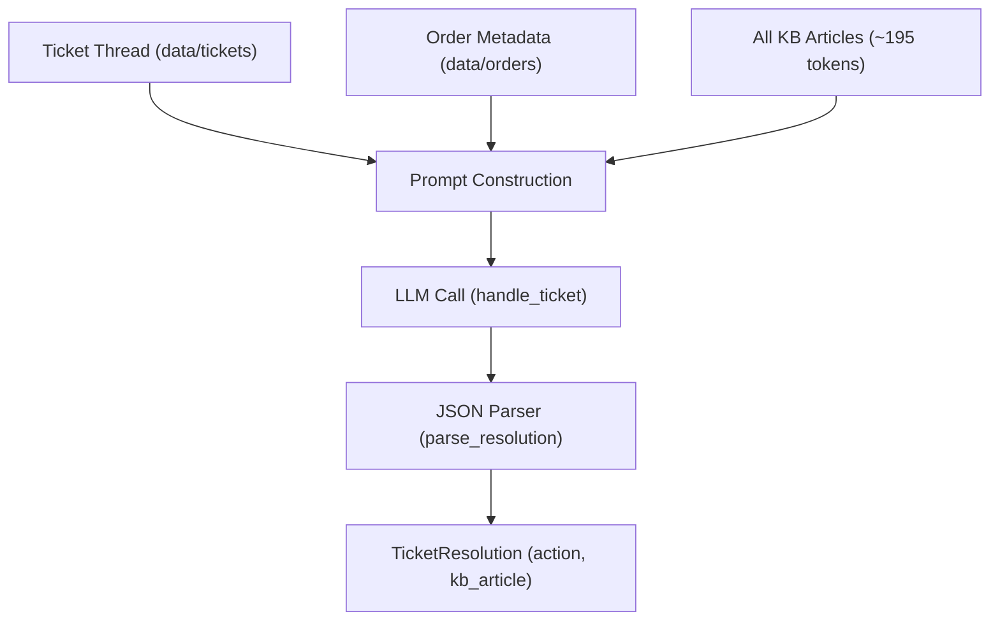
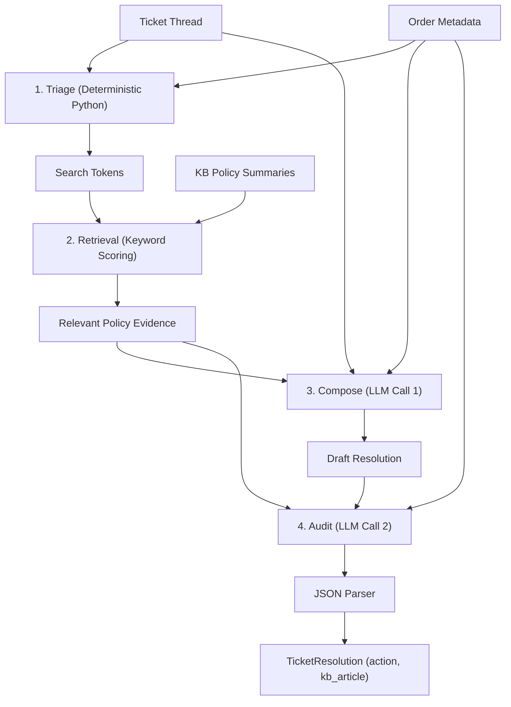

# ShopAssist LLM Cost Optimization

ShopAssist is an e-commerce customer support copilot that processes customer ticket threads, evaluates order metadata, selects an appropriate resolution action (`REFUND`, `REPLACE`, `SEND_ARTICLE`, `ESCALATE_TIER2`), and cites the relevant knowledge-base policy.

The goal of this assignment is to reduce simulated LLM billing points across two architecture tracks while preserving expected resolution decisions, policy citations, and structured JSON output.

## Optimization Targets

- **Q1 – Single-call agent:** ≤ 3,000 points per ticket.
- **Q2 – Four-stage pipeline:** ≤ 2,500 points per ticket.
- **Evaluation set:** Public tickets `T-1001` through `T-1004`. Ticket `T-1091` serves as a holdout regression check.

Billing points are calculated by the simulator formula:

```
points = uncached_input × 3 + cached_input × 0.3 + output × 15
```

## Architecture

### Question 1: Single-Call Agent



### Question 2: Four-Stage Pipeline



## Implementation and Optimizations

### Question 1 (`question1/agent.py`)
- **Prompt Stabilization:** Removed dynamic run-UUID generation to keep the prompt prefix stable across invocations.
- **Output Token Reduction:** Removed verbose reasoning prompts (`step by step`, `full reasoning`, `quote any article`), reducing completion length from ~485 tokens to ~40 tokens of concise JSON and saving ~6,600 billing points per ticket.
- **Direct KB Context:** Retained all five knowledge-base articles in the prompt. At ~195 tokens total, embedding the full corpus is cheaper and more reliable than introducing dynamic retrieval.
- **Order Snapshot:** Preserved the full `ORDER_SNAPSHOT` block with its existing indentation as required by the simulator's decision extractor.

### Question 2 (`question2/agent.py`)
- **Deterministic Triage & Retrieval:** Replaced the unoptimized LLM calls for triage and retrieval with deterministic Python logic. Triage extracts key metadata flags (damage, custom item, digital license), and retrieval scores candidate policies using keyword overlap.
- **Context De-bloating:** Removed the expanded help-center content (which fed 120,000 characters to triage and 80,000 characters to audit in the baseline), replacing it with compact policy summaries mapped to `data/kb/`.
- **Two-Call Verification Pipeline:** Preserved the four logical stages while reducing LLM calls from four to two (`compose` and `audit`). Because output tokens cost 15 points each, four calls would consume ~2,760 points on output alone.
- **Independent Audit:** The audit call independently verifies the draft against order facts and policy evidence, catching non-compliant resolutions before returning.

## Results

Averaged measured costs across the four public tickets (`T-1001`–`T-1004`):

| Track | Baseline average | Optimized average | Target | Reduction |
|---|---:|---:|---:|---:|
| Q1 – Single call | 8,865.00 | 1,681.50 | ≤ 3,000 | 81.0% |
| Q2 – Four-stage pipeline | 73,286.25 | 2,339.25 | ≤ 2,500 | 96.8% |

- All four public tickets meet their cost targets.
- Holdout ticket `T-1091` passed regression testing with the expected action and article.
- Across all tested cases, actions and knowledge-base article selections matched expected results.

## Project Structure

```
├── data/                  # Ticket conversations, orders, and source KB policies
├── eval/                  # Reference ground-truth decision logic
├── question1/             # Q1 single-call agent implementation and runner
├── question2/             # Q2 four-stage pipeline implementation and runner
├── shared/                # Billing rules, token counter, and LLM simulator
├── tests/                 # Correctness and cost target test suites
└── diagnostics.py         # Per-call token and points diagnostic script
```

## Setup and Execution

Prerequisites: Python 3.10+ (tested with Python 3.11).

```bash
# Environment setup
python -m venv venv

# Windows activation:
.\venv\Scripts\activate

# Unix / macOS activation:
# source venv/bin/activate

# Install dependencies
pip install -r requirements.txt

# Run test suite
pytest -q

# Run public ticket evaluation
python question1/run.py
python question2/run.py

# Run per-call diagnostic report
python diagnostics.py
```

## Implementation Notes

- **Policy Summaries:** Q2 policy summaries in `_POLICY_SUMMARIES` are derived directly from documents in `data/kb/`. If source policies change, the code dictionary must be updated to match.
- **Cache Contract:** The simulator requires `CACHE_MIN_PREFIX = 1024` tokens for cache hits. Because static prefixes are ~235 tokens, prompts are not artificially padded to trigger caching, and `cached_prefix_tokens = 0` is reported honestly.
